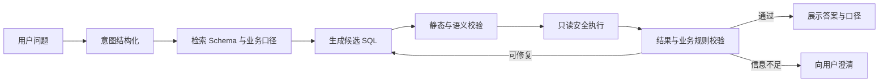

# Text-to-SQL：SQL 能执行但答案不正确，怎么办？

> 面试题：Text-to-SQL 生成的 SQL 可以正常执行，但查询结果不准确，应该如何处理？

## 1. 先纠正一个常见前提

“能执行”只说明 SQL 通过了数据库的语法、对象和类型检查，不代表它正确理解了用户问题。

一条 Text-to-SQL 查询至少有四层正确性：

1. **语法正确**：SQL 能被解析。
2. **执行正确**：表和字段存在，数据库能够返回结果。
3. **语义正确**：表、字段、连接、过滤、聚合和时间范围与问题一致。
4. **业务正确**：SQL 采用了组织真正认可的指标口径、数据范围和权限规则。

因此，“SQL 能执行但不准确”不是异常边角问题，而是 Text-to-SQL 的核心风险。真正要解决的是：如何验证 SQL 与问题的语义和业务口径一致。

## 2. 用一个例子贯穿全流程

用户提问：

> 统计 2024 年华东地区已完成订单的销售额。

简化后的数据表：

```text
orders(
  order_id, region_id, status,
  order_amount, paid_amount, currency,
  created_at, completed_at
)

regions(region_id, region_name)
```

模型生成：

```sql
SELECT SUM(o.order_amount)
FROM orders o
JOIN regions r ON o.region_id = r.region_id
WHERE r.region_name = '华东'
  AND YEAR(o.created_at) = 2024;
```

这条 SQL 可以执行，但可能同时犯了三个错误：

- 没有过滤 `status = 'completed'`；
- “销售额”的公司口径可能是实付金额 `paid_amount`，而不是订单原价 `order_amount`；
- “2024 年已完成订单”可能应按 `completed_at`，而不是创建时间 `created_at`。

数据库不会因为这些业务错误而报错，甚至会返回一个看起来非常合理的数字。

## 3. 为什么会出现“可执行但不正确”

### 3.1 Schema Linking 错误

Schema Linking 是把自然语言中的概念映射到表、字段和枚举值。例如把“销售额”映射到 `paid_amount`，把“华东”映射到 `region_name='华东'`。

常见错误包括：

- 选错同名或近义字段；
- 漏掉中间关联表；
- 不知道状态码 `2` 代表“已完成”；
- 只看字段名，没有看到字段说明、样例值和数据类型。

### 3.2 业务口径缺失

数据库 Schema 通常只能告诉模型“有哪些字段”，不能告诉它：

- 销售额是含税、未税、下单金额还是实付金额；
- 退款单是否冲减；
- 测试订单是否排除；
- “本月”按自然月、财务月还是账期；
- “客户数”按账户、企业主体还是统一社会信用代码去重。

这些规则如果没有进入模型上下文，仅靠提示词很难猜对。

### 3.3 Join 导致重复计数

订单表与订单明细表是一对多关系。直接连接后再统计订单数，可能把一张订单重复计算多次。

```sql
-- 能执行，但可能重复计数
SELECT COUNT(o.order_id)
FROM orders o
JOIN order_items i ON o.order_id = i.order_id;
```

正确写法可能需要 `COUNT(DISTINCT o.order_id)`，也可能应先聚合明细再连接。具体取决于指标粒度。

### 3.4 时间、NULL、单位和枚举错误

这类 SQL 往往也能执行：

- 用创建时间代替支付或完成时间；
- 用服务器时区代替业务时区；
- 忽略 `NULL`、取消单和软删除记录；
- 把元和分直接相加；
- 混合不同币种；
- 把“有效”错误映射成某个状态值。

### 3.5 聚合粒度错误

用户问“每个地区每月销售额”，SQL 却只按地区分组；或者模型选出的字段没有进入 `GROUP BY`。有些数据库会报错，有些配置下却能执行并返回不稳定或错误的值。

## 4. 正确的解决思路：不要只在生成后补一个检查器

可靠方案应覆盖生成前、生成中、执行前、执行后和回答前五个阶段。



## 5. 第一步：先形成结构化查询意图

不要让模型从自然语言一步跳到 SQL。先抽取中间表示，例如：

```json
{
  "metric": "销售额",
  "metric_definition": "实付金额求和",
  "dimensions": ["地区"],
  "filters": ["地区=华东", "订单状态=已完成"],
  "time_field": "完成时间",
  "time_range": ["2024-01-01", "2025-01-01"],
  "grain": "整体",
  "currency": "CNY"
}
```

它的价值不是让模型多输出一段 JSON，而是提供一个可检查的契约：后续可以逐项确认 SQL 是否实现了指标、维度、过滤、时间字段和粒度。

如果“销售额”存在多个合法定义，应在这一步澄清，而不是让模型暗中选择。

## 6. 第二步：补齐 Schema 与语义层

仅把建表语句交给模型通常不够。上下文至少应包含：

- 表和字段的中文说明；
- 主键、外键、表关系和一对一/一对多基数；
- 枚举值及含义；
- 少量脱敏样例值；
- 指标定义、计算公式和适用范围；
- 默认过滤规则，如排除测试数据、软删除数据；
- 时间字段的业务含义、时区和单位；
- 权限与租户隔离规则。

这部分常被称为**语义层**：它把数据库字段翻译为稳定的业务概念。语义层比单纯扩大提示词更关键，因为模型不能从列名可靠推断组织口径。

## 7. 第三步：生成候选 SQL，而不是盲信第一条

可以生成多个候选 SQL，但“多数投票”不能证明正确。候选应来自受控差异，例如不同 Join 路径、时间字段或指标公式，并保留每个候选的假设。

生成时应施加约束：

- 只允许查询授权的表和字段；
- 默认只读，禁止 DDL/DML；
- 明确 Join 路径与基数；
- 时间范围用半开区间，减少边界错误；
- 先限制扫描量和返回行数；
- 要求输出所采用的指标口径和关键假设。

## 8. 第四步：执行前做静态校验

应使用 SQL Parser 把 SQL 转成 AST（抽象语法树），不要仅用正则表达式检查。

可检查：

- 是否只包含 `SELECT`；
- 是否访问了未授权表或字段；
- 字段、函数和方言是否匹配目标数据库；
- Join 是否缺少条件，是否走了允许的关联路径；
- 聚合字段、维度和 `GROUP BY` 是否一致；
- 用户明确要求的地区、状态和时间条件是否缺失；
- 是否存在笛卡尔积、无限制全表扫描或异常大的 `LIMIT`。

然后将“用户问题 + 结构化意图 + SQL AST”交给语义校验器逐项对齐。

重要边界：AST 能证明 SQL 的结构是什么，但不能独立证明“销售额就应该等于实付金额”。业务口径仍然必须来自语义层或用户确认。

## 9. 第五步：执行后检查结果

执行成功后仍要做结果级验证：

### 9.1 基础异常检查

- 结果为空，但历史上该范围通常有数据；
- 行数、金额、日期或比例超出合理范围；
- 本应唯一的维度出现重复；
- 金额包含多币种，却没有换算或分组；
- 分项之和与总计不一致。

### 9.2 不变量检查

不变量是业务上应长期成立的约束，例如：

- 已完成订单数不能大于全部订单数；
- 退款金额通常不应大于对应支付金额；
- 地区分项求和应与同口径全国总额一致；
- 百分比应处于合理区间。

### 9.3 对照查询

为高风险指标生成更简单的控制查询。例如同时查询：

- 2024 年全部订单数；
- 2024 年已完成订单数；
- 华东已完成订单金额；
- 按月拆分后的金额之和。

对照查询不是为了“多跑几条就一定正确”，而是用冗余证据发现过滤遗漏、Join 放大和聚合粒度错误。

### 9.4 执行计划与数据剖析

`EXPLAIN` 可以发现意外全表扫描、Join 顺序和估算行数异常；抽样或剖析可以检查枚举值、NULL 比例和字段分布。但性能正常仍不等于语义正确。

## 10. 第六步：失败后如何修复

修复循环应使用明确的错误证据，而不是只提示“再想一遍”：

1. 把缺失过滤、可疑 Join、结果异常等诊断反馈给模型；
2. 让模型修改 SQL，并说明修改了哪项假设；
3. 再次经过静态校验和受限执行；
4. 达到最大重试次数后停止；
5. 若问题来自口径歧义，向用户提一个关键澄清问题。

例如：

> 你说的“销售额”是订单原价、实付金额，还是扣除退款后的净销售额？

此时追问比自动选择更可靠。

## 11. 风险分级与展示策略

不应对所有问题采用同样强度的校验。

- **低风险**：列表查询、探索性分析。可以展示结果并标注 SQL 与假设。
- **中风险**：运营统计。需要语义校验、结果检查和可追溯口径。
- **高风险**：财务、合规、医疗或直接驱动业务动作。需要固定指标模板、审批或人工复核，不能只依赖模型自评。

最终答案应展示：

- 查询结果；
- 采用的指标定义；
- 时间范围和过滤条件；
- 数据来源与更新时间；
- SQL 或可展开的查询逻辑；
- 未确认假设和置信度。

这让用户能够判断“答案是否回答了我真正的问题”，而不是只看到一个数字。

## 12. 如何评估系统是否真的变准

### 12.1 不要只看 Exact Match

SQL 文本完全匹配过于严格：不同 SQL 可能得到相同正确结果；同时，一条与标准 SQL 很像的查询也可能在边界数据上出错。

### 12.2 建议组合指标

- **Execution Accuracy**：结果是否与标准答案一致；
- **Test-suite Accuracy**：在多组专门构造的数据上是否都正确，减少偶然等价；
- **语义槽位准确率**：表、字段、Join、过滤、聚合、时间和排序分别是否正确；
- **业务答案准确率**：最终数字和口径是否被业务人员接受；
- **澄清率**：系统在歧义问题上是否正确选择追问；
- **安全违规率**：是否越权、写库或超量扫描；
- **延迟与成本**：多候选、校验和重试带来的工程成本。

测试集要覆盖正常问题，也要专门覆盖：一对多 Join、NULL、跨币种、边界日期、同义字段、枚举映射、空结果和口径歧义。

## 13. 常见但不充分的方案

### “让大模型自我反思一次”

可以提高部分样例的正确率，但模型可能重复同一个错误，不能替代外部规则与执行证据。

### “SQL 能执行就通过”

只能过滤语法和对象错误，正是题目所指出的失败模式。

### “生成三条，少数服从多数”

三个候选可能共享同一错误前提。只有候选独立、且有语义与结果证据时才有价值。

### “把整个数据库 Schema 塞给模型”

上下文过大可能降低 Schema Linking 的准确率，也不能补出数据库里不存在的业务定义。应先检索相关 Schema，再补充语义层。

### “再加一个 LLM Judge”

LLM Judge 可作辅助，但它仍可能被错误 SQL 的表面合理性误导。高风险场景必须配合确定性规则、对照查询和人工确认。

## 14. 面试时的 30 秒回答

> SQL 能执行只代表语法和数据库对象有效，不代表语义和业务口径正确。我会把问题拆成生成前、执行前和执行后三层：生成前用语义层补齐指标定义、表关系、枚举和时间口径，并先抽取结构化意图；执行前用 SQL AST 校验表字段、Join、过滤、聚合、权限和只读约束，再比较 SQL 是否覆盖意图；执行后检查空值、范围、不变量、分项与总计，并对高风险指标运行对照查询。发现歧义就向用户澄清，发现可修复错误才进入有上限的重试。评估不能只看 SQL 文本或是否执行，要结合执行准确率、测试集准确率、语义槽位、业务答案和安全指标。

## 15. 面试时的两分钟展开框架

可以按以下顺序回答：

1. **定性问题**：可执行不等于语义正确。
2. **举反例**：销售额字段、完成状态和时间字段都可能选错。
3. **生成前治理**：语义层、Schema 检索、结构化意图和歧义澄清。
4. **执行前治理**：AST、权限、Join、过滤、聚合与意图覆盖检查。
5. **执行后治理**：范围、不变量、控制查询和结果一致性检查。
6. **生产边界**：高风险指标走固定模板或人工复核。
7. **评估闭环**：错误分类、回归集和多维指标，而非只看执行成功率。

如果面试官继续追问“能不能保证 100% 正确”，应明确回答：

> 对开放域自然语言和不断变化的业务口径，不能仅靠模型保证 100% 正确。工程目标是通过语义治理、验证、追问、权限和人工兜底，把错误变得可检测、可解释、可阻断，并在限定领域内持续提高正确率。

## 16. 落地检查清单

### 数据与语义

- [ ] 字段描述、枚举和样例值是否可检索？
- [ ] 主外键和关系基数是否明确？
- [ ] 指标公式、默认过滤、单位和时区是否版本化？

### 生成与验证

- [ ] 是否先抽取指标、维度、过滤、时间和粒度？
- [ ] SQL 是否经过 Parser/AST，而非只用正则？
- [ ] 是否检查 Join 放大、过滤遗漏和聚合粒度？
- [ ] 是否有只读、权限、超时和扫描量限制？

### 结果与产品

- [ ] 是否检查空结果、范围、不变量和控制查询？
- [ ] 歧义是否会触发澄清，而不是静默猜测？
- [ ] 是否展示口径、过滤、数据来源和未确认假设？
- [ ] 高风险结果是否需要人工复核？

### 评估

- [ ] 是否按错误类型维护回归集？
- [ ] 是否同时评估执行结果、语义槽位、业务口径和安全？
- [ ] 是否记录每次生成、校验、执行和修复的可观测链路？

---

核心结论：**Text-to-SQL 的可靠性不来自“SQL 跑通了”，而来自问题、业务语义、SQL 结构和查询结果之间存在一条可验证的证据链。**