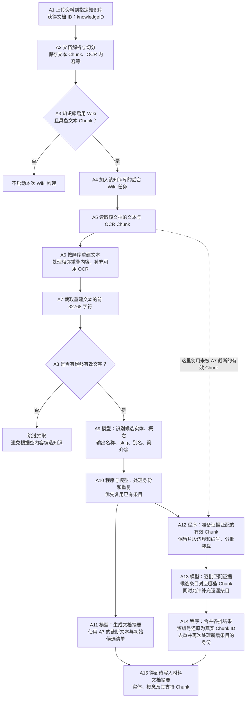
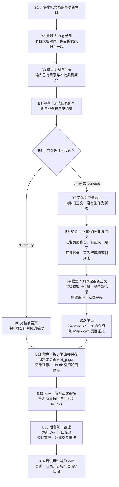
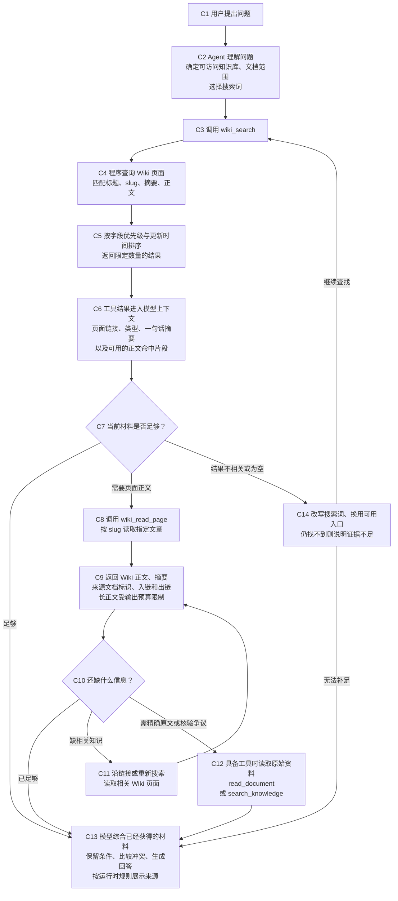
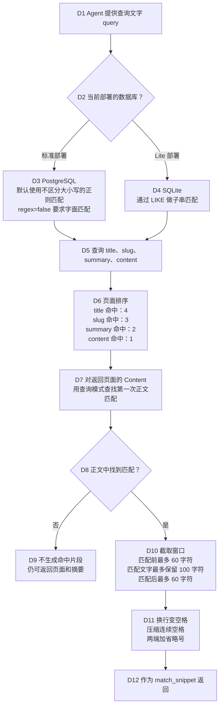
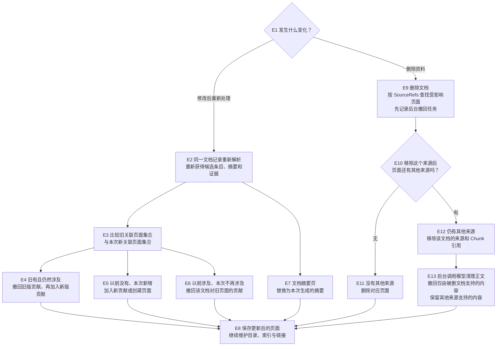

# WeKnora Wiki 构建与检索流程

本文用于回顾 WeKnora 如何将原始资料编译成 Wiki、维护目录与页面链接，以及如何检索 Wiki 并参与问答。流程以中文说明业务行为，不要求阅读 Go 语法。

- 整理日期：2026-11-04。
- 依据版本：`314a6fafd718724b5e6a11b42650b51db6b588d8`，来自本地代码快照。
- 检索范围：Wiki Agent 的 `wiki_search → wiki_read_page` 链路；原始文档检索按需参与。
- 图中标注“模型”的节点需要调用 LLM；其他节点主要由程序执行。
- 本文描述代码中的工作流程，不代表已完成真实模型的端到端运行验证。

## 阅读索引

| 想回顾的问题 | 对应章节 |
| --- | --- |
| 原始文档怎样变成候选条目、摘要和证据 | 图 1：文档读取、抽取与证据匹配 |
| 怎样编写正文、保存页面、建立目录和链接 | 图 2：页面生成、目录与链接维护 |
| Wiki 怎样被检索并用于回答 | 图 3：检索与问答 |
| 用什么方式匹配页面，片段怎样截取 | 图 4：匹配与命中片段 |
| 报告修改、删除后怎样处理 | 图 5：更新与删除 |
| 每次模型调用使用哪个提示词 | 提示词速查 |
| 各阶段输入与输出是什么 | 关键输入输出与字段速查 |

## 先明确几个边界

1. **构建范围是单个知识库。** 不同知识库分别维护页面；跨库搜索不等于持久化构建全局 Wiki。
2. **页面是一篇知识文章。** 例如《X100 电池》或《快充》，与 PDF 的第几页无关。
3. **主要存储是数据库。** Markdown 正文保存在 `wiki_pages.Content`；并不要求在磁盘上存在同名 `.md` 文件。
4. **原始 Chunk 与 Wiki 命中片段不同。** 前者是原始资料切分后的数据，后者是从生成后的 Wiki 正文中临时截出的文字。
5. **Wiki 图是页面链接图。** 一条边表示页面之间存在链接，不直接表达“生产”“影响”等带类型的语义关系。
6. 用户自定义的领域图谱 Schema、本体和全局 Wiki，属于另外讨论的产品扩展设计，不混入下面的现有流程。

## 图 1：文档读取、抽取与证据匹配



### 1.1 文本重建和截断

Wiki 处理复用已经保存的 Chunk，按顺序重建文本，处理相邻重叠内容，并补充可用 OCR。随后取前 `32768` 个 Unicode 码点，近似理解为字符，作为初始候选抽取和文档摘要的正文输入。

这一步不是滑动窗口遍历全文，也不是从每个 Chunk 各取一部分。截断只影响准备给这一轮模型的文本，不会删除原始资料或原始 Chunk。

字符数不等于 Token 数，固定字符上限也不能单独保证所有模型请求都满足上下文限制。

### 1.2 候选实体与概念

候选抽取的输出分为两类：

- `entities`：具体具名对象，例如 X100 电池、某家公司。
- `concepts`：抽象概念、方法或主题，例如快充、循环寿命。

每个候选条目主要包含 `name`、`slug`、`aliases`、`description`、`details`。这时获得的是候选知识条目，不是完整 Wiki 正文。

抽取粒度有 `focused`、`standard`、`exhaustive` 三档。它们通过提示词指导模型控制抽取范围，不保证每次生成完全相同的条目。

`PreviousSlugs` 指这份文档以前关联的条目，不是整个知识库的所有页面。跨文档复用还要经过后续去重。

### 1.3 身份匹配与去重

程序使用新条目的名称、别名查找相似候选，并补充检查规范化后的同名页面。确定性规则可以优先复用已有页面；名称变体和语义匹配则可能调用去重模型。

模型要求判断是否指向完全相同的对象或概念。名称相近、属于同一类别或仅共享缩写，都不足以证明身份相同。程序还会约束模型只能合并到为该条目提供的候选目标，并检查类型前缀。

模型的合并建议示意如下：

```json
{
  "merges": {
    "entity/x100": "entity/x100-battery"
  }
}
```

它只确定新材料应归入哪个条目，正文尚未合并。同名复用和模型判断仍可能出错；严格的人工待确认机制不能假定已经完整实现。

### 1.4 摘要与证据是并行分支

| 对比项 | 文档摘要分支 A11 | 证据匹配分支 A12 至 A14 |
| --- | --- | --- |
| 正文输入 | A7 的截断文本 | 该文档用于证据匹配的有效 Chunk |
| 主要任务 | 概括这份文档 | 找出每个条目的原文支持 |
| 调用方式 | 生成文档摘要 | 分批读取 Chunk |
| 能否补充遗漏条目 | 不承担此任务 | 可以通过 `new_slugs` 补充 |
| 是否自动补全文档摘要 | — | 不会因补出条目而重新总结全文 |

证据匹配按累计约 `12000` 字符装成一批，最多同时处理 `4` 批。批次之间不额外增加重叠；原始 Chunk 自身可能已有重叠。单个超长 Chunk 会独立成批，不在这里继续切小。

每批输入是“候选条目清单＋带临时编号的原文 Chunk”。模型主要返回条目与片段的对应关系，并可补充重要遗漏项。

```json
{
  "citations": {
    "entity/x100-battery": ["c000", "c001"],
    "concept/fast-charging": ["c001"]
  },
  "new_slugs": [
    {
      "type": "concept",
      "name": "循环寿命",
      "slug": "concept/cycle-life",
      "aliases": [],
      "description": "报告讨论的电池性能主题。",
      "details": "报告说明了循环寿命的观察方式及结果适用范围。",
      "source_chunks": ["c002"]
    }
  ]
}
```

以上 JSON 是格式示例，不是真实模型调用结果。`c000` 等是当前批次的临时编号，程序会映射回真实 Chunk ID。一个 Chunk 可以支持多个条目。

如果初始候选清单为空，当前证据分类函数会直接返回。初次抽取失败时也可以退回旧版抽取流程，此时不执行正常的 Chunk 分类。没有获得 Chunk 引用的条目仍可能使用 `description`、`details` 作为后备材料，因此不能理解为没有精确引用就一定禁止写页。

## 图 2：页面生成、目录与链接维护



### 2.1 分类目录

目录规划发生在本批页面并行编写之前。模型根据已有目录、条目名称、类型和简介，为条目提出最多两层分类路径。程序清洗路径并创建或复用 `wiki_folders`。

示例输出：

```json
{
  "assignments": [
    {"slug": "entity/x100-battery", "path": ["产品", "电池"]},
    {"slug": "concept/fast-charging", "path": ["电池技术", "充电技术"]}
  ]
}
```

`slug` 定位文章，`path` 表示分类位置，两者用途不同。移动目录不必改变 slug。自动规划只应用于尚未分类的页面，已有位置和用户调整的位置会保留。

### 2.2 页面编写

页面编辑模型的材料主要包括：

| 输入 | 用途 |
| --- | --- |
| 页面名称、slug、类型、别名 | 明确这篇文章描述什么 |
| 旧页面正文 | 保留已经积累的有效信息；不存在时按新页处理 |
| 新的相关原文 Chunk | 支持本次新增事实 |
| 来源文档摘要 | 理解背景、来源类型和适用范围，不作为新增事实的替代证据 |
| 有效页面链接 | 约束允许出现的跳转地址 |
| 编辑规则及配置指令 | 约束合并、撤回、冲突和表达方式 |

模型被要求贴近证据，保留条件，不自行扩写事实。明确的新证据可以更新旧信息并说明变化；未解决或依据不足的冲突，不应静默覆盖。

模型输出完整的新正文，而非只输出追加内容：

```markdown
SUMMARY: X100 电池已有两组不同条件下的循环测试记录。

# X100 电池

- 报告 A：25°C、1C 条件下的测试记录……
- 报告 B：45°C、3C 条件下的测试记录……
```

这个输出中的 `SUMMARY` 是 X100 页面的一句话介绍，与“报告 A 的摘要页”不同。程序将第一行与 Markdown 正文分开保存。

### 2.3 页面链接与反向记录

链接形式：

```markdown
[[concept/fast-charging|快充]]
```

- `concept/fast-charging`：目标页面地址。
- `快充`：用户看到的可点击文字。

链接可以由模型在写正文时生成，也可以由程序后处理时匹配已知名称、别名并补上。自动补链是文字匹配处理，不调用 LLM；主要处理本批受影响页面及相关候选链接，不会每次重扫全部历史页面。

例如 X100 正文链接到快充页面：

```text
X100 电池页 ──链接到──→ 快充页

X100.OutLinks 包含：concept/fast-charging
快充.InLinks 包含：entity/x100-battery
```

`InLinks` 是程序维护的反向记录，不表示快充的正文自动出现返回 X100 的链接。正文链接更新后，程序重新提取出链，并同步维护目标页入链。

### 2.4 Wiki 入口

入口主要由“模型生成的简介＋程序查询的页面列表和分类”组成。当前版本不把所有目录内容作为一份巨大 Markdown，每批都交给模型重写。页面列表可分页读取。

## 图 3：检索与问答



### 3.1 不是每个问题都强制走完全部步骤

Agent 根据具体信息缺口选择工具。搜索结果足够时可以直接回答，不一定再读正文；用户询问 Wiki 总览时，也可以先读取 `index`。混合模式遇到精确原话、数字、代码等问题时，可以优先检索原始资料。

这些要求写在 Agent 系统提示词里，属于工具使用指导，并非每次都强制执行的固定步骤。原始资料读取后仍有缺口时，Agent 也可以继续查找；图中省略了反复取证的循环。

### 3.2 真正进入问答上下文的是什么

| 工具 | 模型看到的材料 |
| --- | --- |
| `wiki_search` | Wiki 页面链接、类型、摘要、适用时的别名和正文命中片段 |
| `wiki_read_page` | Wiki 页面正文、摘要、来源文档标识、InLinks、OutLinks |
| `search_knowledge`、`read_document` | 原始资料的检索片段或文档内容，取决于具体工具调用 |

`wiki_read_page` 读取的正文来自 `wiki_pages.Content`。它不会因为页面存在 `ChunkRefs`，就自动读取所有关联原始 Chunk 并一起交给模型。精确原文需要另外调用相应工具。

工具结果会作为消息加入模型上下文，参与后续回答，而不只是供界面展示。长页面正文受工具输出预算限制，可能被裁剪。

`InLinks` 和 `OutLinks` 提供继续探索的线索；Agent 不需要遍历全部链接，也没有固定必须阅读的页面数或跳数。

## 图 4：匹配与命中片段



### 4.1 匹配方式与排序

PostgreSQL 与 SQLite 是不同部署使用的数据库选择，通常使用其中一个；不是分别存 Wiki 和 Chunk，也不是依次查询两个数据库。

| 部署 | Wiki 搜索方式 |
| --- | --- |
| PostgreSQL | `~*`，不区分大小写的正则匹配 |
| SQLite | `LIKE`，匹配是否包含查询文字 |

这条 `wiki_search` 路径没有中文分词、BM25 排序、向量相似度或自动同义词扩展。Agent 可以根据问题选择或改写搜索词，但这与数据库做分词检索是两回事。

PostgreSQL 查询示例：

| 查询 | 含义 |
| --- | --- |
| `快充` | 查找“快充” |
| `快充\|循环寿命` | 匹配“快充”或“循环寿命”，仅适用于 PostgreSQL 正则路径 |
| `快充 循环寿命` | 不会自动拆词，按包含空格的表达式匹配 |

SQLite 不具备相同的正则“或”语义。Agent 工具会处理 `regex` 参数及不合法表达式，但具体数据库仍决定查询能力。

页面排序取最高命中字段等级，不是四项相加；同等级按 `updated_at` 降序。当前底层匹配字段没有 `Aliases`，虽然工具描述提到别名搜索。

### 4.2 命中片段截取

程序在 Wiki 正文中使用不区分大小写的正则查找，选择第一次命中，截取前后各最多 60 个 Unicode 码点。匹配文字自身超过 100 个码点时，只保留其前 100 个并加省略号；后方窗口从完整匹配的结束位置计算。

随后将换行替换为空格，压缩连续空格，并在两端加省略号。这一步不调用模型。

| 问题 | 行为 |
| --- | --- |
| 来自整个 Content 还是局部 | 局部窗口；正文短时可能恰好覆盖全文 |
| 多处命中取哪处 | 第一次，不比较哪处最有价值 |
| 按完整句子、段落边界截取吗 | 不按，是固定字符窗口 |
| 按原始 Chunk 边界截取吗 | 不按，它操作的是 Wiki 正文 |
| 每个页面返回几个窗口 | 最多一个 |
| 标题或摘要命中，但正文未命中 | 可以返回页面和摘要，不返回正文命中片段 |

命中片段可能截断实验条件，也可能漏掉正文后面更详细的论述，因此它主要用于判断页面是否值得进一步阅读。

## 图 5：更新与删除



### 5.1 同一文档重新解析

| 新旧关联关系 | 处理方向 |
| --- | --- |
| 旧页面仍然出现 | 对实体、概念页面同时准备旧贡献撤回与新贡献加入 |
| 旧页面本次不再出现 | 撤回该文档对旧页面的贡献 |
| 新出现的页面 | 创建新页或加入对应已有页 |
| 文档摘要页 | 用新生成的摘要整体替换 |

同一资料记录的版本更新，与另外上传一个文件不同。后者可能作为新增来源，不自动保证替换旧版本。

### 5.2 文档删除

程序按 `SourceRefs` 找到受影响页面，先记录后台撤回任务，再处理来源记录：

- 移除来源后没有其他来源：删除对应页面。
- 仍有其他来源：保留页面，清理被删资料的来源与 Chunk 引用，后台再处理正文。

Wiki 系统入口页不按普通文档派生页处理。

### 5.3 撤回精度的局限

当前正文撤回主要依赖摘要信息和模型判断，不是按逐句结论与证据绑定做精确减法。

- 重解析时，用旧文档摘要正文帮助识别旧贡献。
- 删除任务通常携带该资料的一句话摘要；剩余来源主要提供其摘要正文。
- 摘要漏掉细节时，撤回或保留的判断可能不准确。
- 来源记录更新和正文后台重写存在时间差。

因此，页面级 `ChunkRefs` 不等于每一句结论都已经精确关联到某个原文段落。需要更精确的撤回时，还要补充结论与证据的结构化绑定。

## 提示词速查

| 提示词 | 节点 | 职责 |
| --- | --- | --- |
| `WikiCandidateSlugPrompt` | A9 | 从截断文本识别候选实体、概念 |
| `WikiDeduplicationPrompt` | A10 | 判断不同名称是否指向同一对象或概念 |
| `WikiSummaryPrompt` | A11 | 生成文档摘要 |
| `WikiChunkCitationPrompt` | A13 | 匹配支持 Chunk，补充遗漏条目 |
| `WikiTaxonomyPlanPrompt` | B3 | 规划分类目录 |
| `WikiPageModifySystemPrompt` 与 `WikiPageModifyUserPrompt` | B9、E13 | 创建、更新正文，处理撤回与冲突 |
| `WikiIndexIntroPrompt` 与 `WikiIndexIntroUpdatePrompt` | B13 | 创建或更新 Wiki 入口简介 |
| Wiki Researcher 与混合模式系统提示词 | C2 至 C13 | 指导搜索、读页、回查原文和回答 |

## 关键输入输出与字段速查

### 页面字段

| 字段 | 含义 |
| --- | --- |
| `KnowledgeBaseID` | 所属知识库 |
| `Slug` | 稳定定位地址，例如 `entity/x100-battery` |
| `Title` | 展示标题 |
| `PageType` | summary、entity、concept、index、synthesis、comparison |
| `Summary` | 当前页面的一句话概述 |
| `Content` | Markdown 正文 |
| `Aliases` | 指向同一对象或概念的其他名称 |
| `SourceRefs` | 对页面有贡献的来源文档 |
| `ChunkRefs` | 页面关联的支持片段 ID |
| `FolderID` | 页面所在的分类目录 |
| `InLinks` | 哪些页面链接到当前页 |
| `OutLinks` | 当前页链接到哪些页面 |
| `Version` | 用户可见内容版本；纯链接等维护不一定增加版本 |

普通文档摄取主要形成 summary、entity、concept，并维护 index。synthesis 和 comparison 主要由 Agent 通过写页工具创建，不是普通摄取必然生成的产物。

### 任务输出

| 阶段 | 输入 | 输出 |
| --- | --- | --- |
| 初始抽取 | 截断正文、语言、抽取粒度、历史关联 slug | entities、concepts |
| 身份去重 | 新条目与其对应的已有候选 | merges 或确定性复用结果 |
| 文档摘要 | 截断正文、初始候选清单 | SUMMARY 行与 Markdown 摘要 |
| 证据匹配 | 候选清单、一批带编号原文 | citations、new_slugs |
| 目录规划 | 已有目录、条目简介 | assignments：slug 对应分类路径 |
| 页面编辑 | 页面身份、旧正文、新原文、来源背景、规则 | SUMMARY 行与完整新正文 |
| Wiki 搜索 | query、结果数量及范围 | 页面线索、摘要、可用命中片段 |
| Wiki 读页 | slug | 正文、摘要、来源标识、页面链接关系 |

## 回顾时容易混淆的区别

1. 原始资料的 Chunk，不是 Wiki 正文中临时截取的命中片段。
2. 初次截断抽取，不是后续分批证据匹配；后者补出条目，不等于补全文档摘要。
3. 候选条目，不是完整 Wiki 文章；先确定对象与主题，再选证据和写正文。
4. 身份合并解决“是不是同一个对象”，正文合并解决“怎样整合其资料”。
5. 目录位置不是 slug；同名页面也可能分别存在于不同知识库。
6. 页面关联哪些 Chunk，不等于每句话都能精确定位到支持段落。
7. 页面里的 `Summary` 字段，不是“文档摘要页”的全部内容。
8. `InLinks` 是反向记录，不代表目标页正文自动生成返回链接。
9. 全局搜索多个库，不会自动构建一套持久化全局 Wiki。
10. WeKnora Wiki 当前的页面链接规则，不等于用户可定义的完整领域本体。

## 固定版本源码索引

以下链接均固定到本文依据的提交，便于从 Notion 或其他设备打开。源码用于核对依据，不要求阅读其 Go 语法。

| 内容 | 固定版本源码 |
| --- | --- |
| Wiki 任务主入口 | [wiki_ingest_batch.go：ProcessWikiIngest](https://github.com/Tencent/WeKnora/blob/314a6fafd718724b5e6a11b42650b51db6b588d8/internal/application/service/wiki_ingest_batch.go#L260) |
| 单文档处理与截断 | [wiki_ingest_batch.go：mapOneDocument](https://github.com/Tencent/WeKnora/blob/314a6fafd718724b5e6a11b42650b51db6b588d8/internal/application/service/wiki_ingest_batch.go#L1322) |
| 候选抽取、证据分批与原文收集 | [wiki_ingest_cite.go](https://github.com/Tencent/WeKnora/blob/314a6fafd718724b5e6a11b42650b51db6b588d8/internal/application/service/wiki_ingest_cite.go#L65) |
| 页面编写与保存 | [wiki_ingest_batch.go：reduceSlugUpdates](https://github.com/Tencent/WeKnora/blob/314a6fafd718724b5e6a11b42650b51db6b588d8/internal/application/service/wiki_ingest_batch.go#L1890) |
| 目录规划 | [wiki_ingest_taxonomy.go](https://github.com/Tencent/WeKnora/blob/314a6fafd718724b5e6a11b42650b51db6b588d8/internal/application/service/wiki_ingest_taxonomy.go#L25) |
| 生成阶段的提示词 | [prompts_wiki.go](https://github.com/Tencent/WeKnora/blob/314a6fafd718724b5e6a11b42650b51db6b588d8/internal/agent/prompts_wiki.go#L10) |
| Wiki 页面数据结构 | [types/wiki_page.go](https://github.com/Tencent/WeKnora/blob/314a6fafd718724b5e6a11b42650b51db6b588d8/internal/types/wiki_page.go#L188) |
| 出链、入链与页面服务 | [service/wiki_page.go](https://github.com/Tencent/WeKnora/blob/314a6fafd718724b5e6a11b42650b51db6b588d8/internal/application/service/wiki_page.go#L78) |
| 自动补链 | [wiki_ingest.go：injectCrossLinks](https://github.com/Tencent/WeKnora/blob/314a6fafd718724b5e6a11b42650b51db6b588d8/internal/application/service/wiki_ingest.go#L1929) |
| Wiki 搜索与读页工具 | [tools/wiki_tools.go](https://github.com/Tencent/WeKnora/blob/314a6fafd718724b5e6a11b42650b51db6b588d8/internal/agent/tools/wiki_tools.go#L351) |
| 页面匹配与排序 | [repository/wiki_page.go：SearchAcross](https://github.com/Tencent/WeKnora/blob/314a6fafd718724b5e6a11b42650b51db6b588d8/internal/application/repository/wiki_page.go#L1456) |
| 正文命中片段截取 | [searchutil/snippet.go](https://github.com/Tencent/WeKnora/blob/314a6fafd718724b5e6a11b42650b51db6b588d8/internal/searchutil/snippet.go#L11) |
| 问答阶段的工具使用指导 | [agent_system_prompt.yaml](https://github.com/Tencent/WeKnora/blob/314a6fafd718724b5e6a11b42650b51db6b588d8/config/prompt_templates/agent_system_prompt.yaml#L98) |
| 工具结果加入模型上下文 | [agent/observe.go](https://github.com/Tencent/WeKnora/blob/314a6fafd718724b5e6a11b42650b51db6b588d8/internal/agent/observe.go#L1098) |
| 文档重解析时替换贡献 | [wiki_ingest_batch.go：新旧集合比较](https://github.com/Tencent/WeKnora/blob/314a6fafd718724b5e6a11b42650b51db6b588d8/internal/application/service/wiki_ingest_batch.go#L1678) |
| 文档删除后的 Wiki 清理 | [knowledge_delete.go](https://github.com/Tencent/WeKnora/blob/314a6fafd718724b5e6a11b42650b51db6b588d8/internal/application/service/knowledge_delete.go#L261) |
